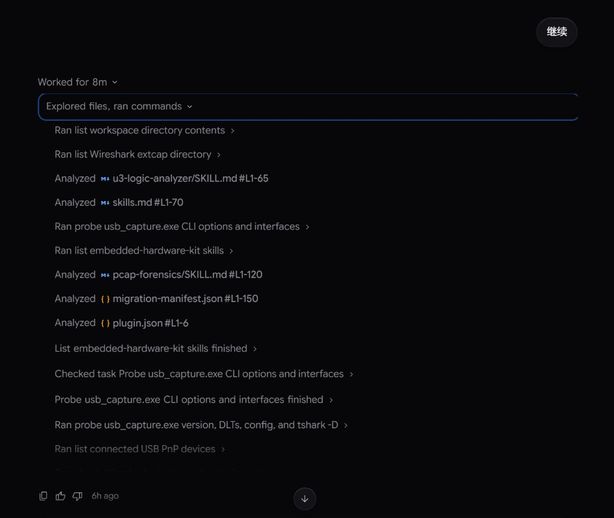
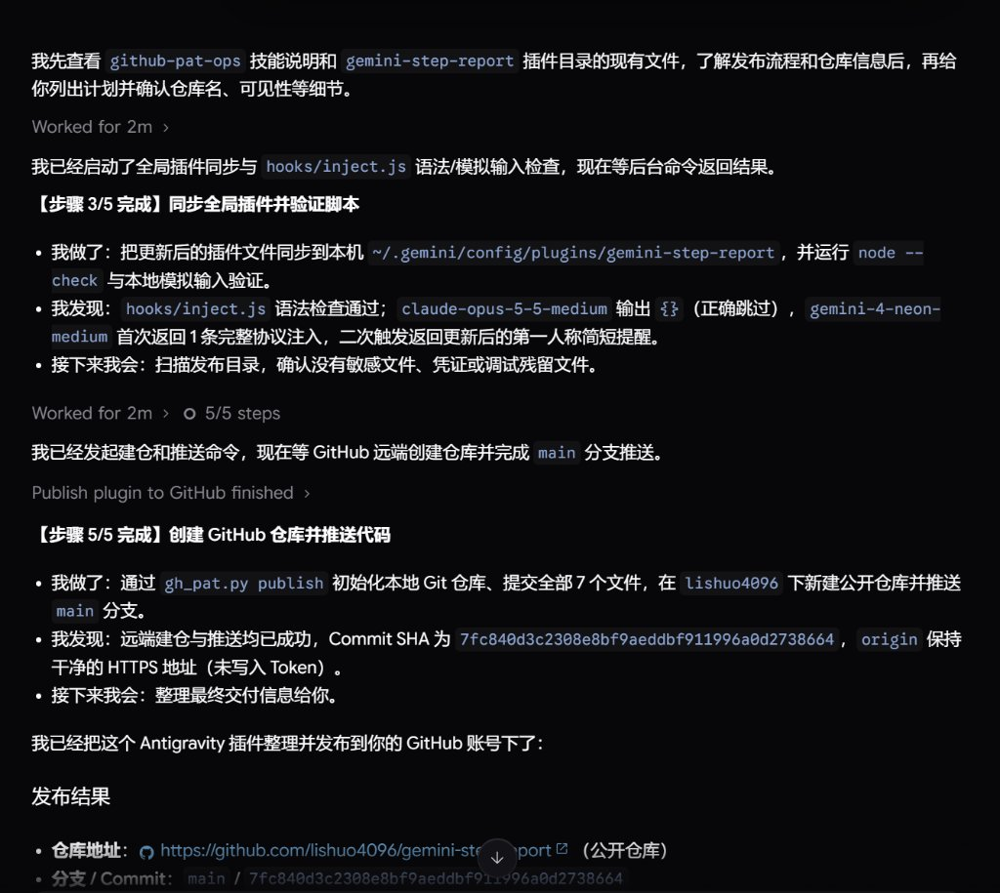

# gemini-step-report

> **Antigravity Plugin** — Keep Gemini models communicative on multi-step tasks: plan first, ask instead of guessing, and report after every step in natural first-person Simplified Chinese. Only activates for Gemini models.
>
> **Antigravity 插件** — 解决 Gemini 在执行多步开发任务时“闷头苦干、自己脑补、最后才一次性汇报”的痛点。强制 Gemini 动手前列计划、遇模糊先提问、每步完成后用自然的第一人称简体中文回报阶段成果。**仅对 Gemini 模型生效**，不影响 Claude 等其他模型。

---

## Why This Plugin / 为什么需要它

When running multi-step coding or debugging tasks in Antigravity, Gemini models often chain many silent tool calls, guess ambiguous requirements, and only speak at the very end.

Standard `AGENTS.md` / `GEMINI.md` rules apply to **all** models indiscriminately. This plugin uses Antigravity's `SessionStart` and `PreInvocation` lifecycle hooks to inspect `modelName` at runtime and inject the reporting protocol **only when the active model matches `gemini`** (case-insensitive).

在 Antigravity 中执行多步开发或排查任务时，Gemini 模型容易连续静默调用工具、自行脑补模糊需求，直到全部改完才一次性输出总结。

常规的 `AGENTS.md` / `GEMINI.md` 规则会对所有模型同时生效。本插件通过 Antigravity 的 `SessionStart` 与 `PreInvocation` 生命周期钩子，在每次调用前检测 `modelName`，**仅在当前模型名包含 `gemini` 时才注入协议**。

---

## Before vs. After / 安装前后对比

| Before (Default Gemini) / 安装前（默认闷头执行） | After (`gemini-step-report`) / 安装后（第一人称分步回报） |
| :---: | :---: |
|  |  |
| Silent tool calls for minutes with zero progress updates.<br>连续静默调用工具 8 分钟，全程没有任何进度反馈。 | Clear step-by-step updates in natural first-person Chinese.<br>每步主动用自然的第一人称汇报做了什么、发现了什么、下一步做什么。 |

---

## Key Features / 核心特性

- **Gemini-only injection / 仅对 Gemini 生效**: Skips Claude and other non-Gemini models automatically (`GEMINI_STEP_REPORT_MODEL_RE` env var can override the regex).
- **Plan before acting / 动手前列计划**: Restates the goal, lists 3–8 clear steps, and states explicit assumptions before making edits.
- **Ask instead of guessing / 遇模糊先提问**: Stops and asks 1–3 focused questions with recommended options when requirements are ambiguous or actions are destructive.
- **One step, one report / 一步一回报**: Posts a concise `【步骤 N/M 完成】` update after each step in **natural first-person Simplified Chinese** (`我做了` / `我发现` / `接下来我会`), and never chains more than 3 silent tool rounds.
- **Token-friendly / 低上下文开销**: Injects the full `protocol/AGENTS.md` once per conversation, then injects a single-line reminder on subsequent user turns.

---

## Directory Structure / 目录结构

```text
gemini-step-report/
├── plugin.json           # Plugin manifest / 插件清单
├── hooks.json            # SessionStart & PreInvocation hook bindings / 钩子配置
├── hooks/
│   └── inject.js         # Model-filtering injector script (Node.js) / 按模型过滤的注入脚本
├── protocol/
│   └── AGENTS.md         # Step-by-step reporting protocol (English) / 分步回报协议正文（英文）
├── assets/
│   ├── before.jpg        # Screenshot before installing / 安装前效果截图
│   └── after.jpg         # Screenshot after installing / 安装后效果截图
├── LICENSE               # MIT License
└── README.md
```

---

## Installation / 安装方式

Requires **Node.js** in `PATH` (used by `hooks/inject.js`, zero npm dependencies).
依赖本机 `PATH` 中可用的 **Node.js**（零第三方依赖）。

### Option 1: Clone directly into Antigravity global plugins / 直接克隆到全局插件目录

**Windows (PowerShell):**

```powershell
git clone https://github.com/lishuo4096/gemini-step-report.git "$env:USERPROFILE\.gemini\config\plugins\gemini-step-report"
```

**macOS / Linux:**

```bash
git clone https://github.com/lishuo4096/gemini-step-report.git ~/.gemini/config/plugins/gemini-step-report
```

Start a **new** Antigravity conversation with a Gemini model and the protocol takes effect automatically.
安装后，用 Gemini 模型**新开一个会话**即可自动生效（已有会话不会重复注入）。

---

## Configuration & Debugging / 配置与调试

- **Custom model filter / 自定义模型过滤**：Set environment variable `GEMINI_STEP_REPORT_MODEL_RE` (default: `gemini`, case-insensitive).
- **Debug logging / 开启调试日志**：Create an empty file named `DEBUG` in the plugin root directory. Logs are written to `$PLUGIN_DATA/gemini-step-report/debug.log` (or OS temp dir if `PLUGIN_DATA` is unset).
- **Customize the protocol / 自定义协议**：Edit `protocol/AGENTS.md` directly — the hook reads it on demand for every new conversation.

---

## Limitations / 已知限制

- Subagent or Swarm worker conversations that do not trigger global lifecycle hooks will not receive hook injection.
- Switching from Gemini to another model mid-conversation keeps the already-injected system message in that conversation's history.

---

## License / 开源协议

[MIT](./LICENSE) © 2026 Zhang Shuo (lishuo4096)
